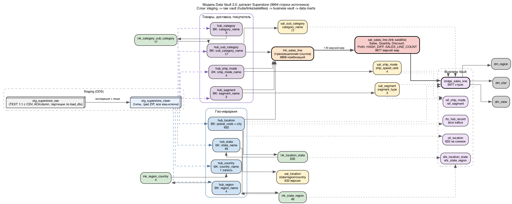
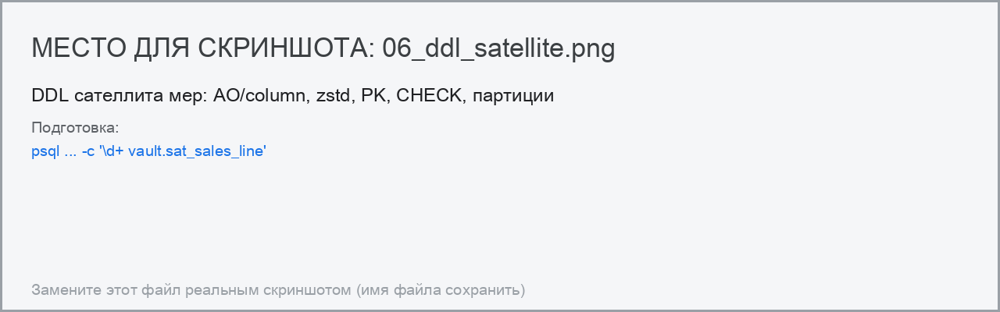
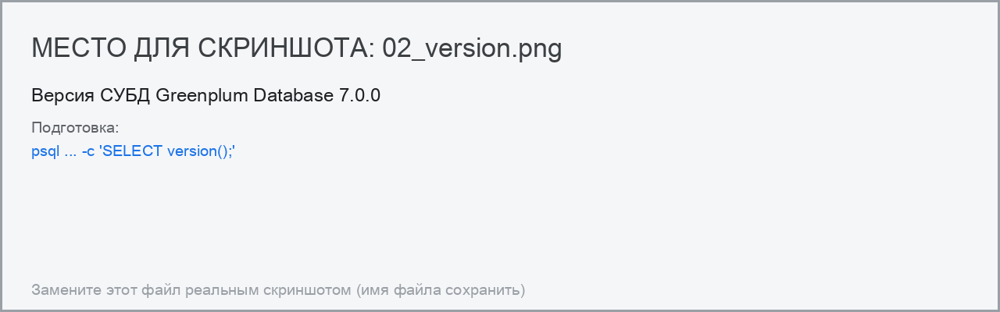
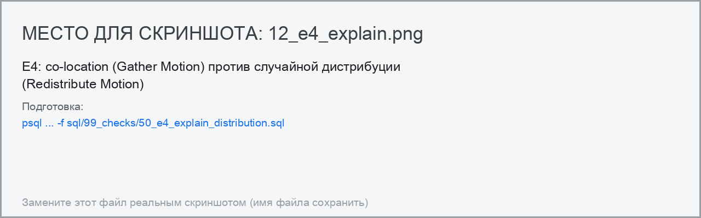

# Бондарев Пётр. Итоговое ДЗ, модуль 1: Data Vault в Greenplum

**Датасет:** Kaggle `roopacalistus/superstore` («Retail Supermarket», файл `SampleSuperstore.csv`).
**СУБД:** Greenplum Database 7.0.0 (локальный кластер: координатор + 4 сегмента в Docker).
**Артефакты работы:** скрипты DDL/ELT — каталоги `sql/`, автотесты — `tests/`, воспроизведение — `Makefile`.

Состав работы по частям задания:

| Часть задания | Что сделано | Где смотреть |
|---|---|---|
| Часть 1. Проектирование | Спроектирована модель Data Vault 2.0: 8 хабов, 5 ссылок, 5 сателлитов + слой Business Vault и витрины; диаграмма и обоснование решений | раздел 2, `docs/report/diagrams/dv_model.png` |
| Часть 2. DDL | 7 комментированных SQL-скриптов создания объектов для Greenplum (схемы, staging, хабы, ссылки, сателлиты, Business Vault, витрины) | раздел 3, `sql/00_init … 05_marts` |
| Часть 3. Реализация | Все объекты созданы и заполнены данными датасета; контрольные суммы сходятся с источником; 118 автотестов проходят | разделы 4–5, `sql/03_load`, `tests/` |
| Сверх программы | Business Vault (PIT/Bridge/EFS/RTS/reference), доказательство выбора дистрибуции через `EXPLAIN ANALYZE`, карантин данных, метрики качества, lineage, CI | раздел 6 |

## 1. Исходные данные и их профиль

### 1.1. Что содержит датасет

В датасете **9994 строки и 13 колонок** — это «плоская» выгрузка строк продаж:

`Ship Mode, Segment, Country, City, State, Postal Code, Region, Category, Sub-Category, Sales, Quantity, Discount, Profit`.

Важно: это **не** классический Superstore-датасет. В нём **нет** `Order ID`, `Customer ID`, `Product ID/Name`,
`Order Date`, `Ship Date`, `Row ID` — то есть **нет идентификаторов событий и нет ни одной даты`.
Именно этот факт определил ключевое проектное решение модели (см. п. 2.4): гранулярность «строка продажи»
пришлось описать как комбинацию бизнес-сущностей, а меры вынести в сателлит ссылки.

### 1.2. Профиль (получен скриптом `src/profile_dataset.py`, не «на глаз»)

| Показатель | Значение |
|---|---|
| Строк в файле | 9994 |
| Колонок | 13 |
| Страна / регион / штат | 1 / 4 / 49 |
| Город / индекс (ZIP) | 531 / 631 |
| Категория / подкатегория | 3 / 17 |
| Способ доставки / сегмент покупателя | 4 / 3 |
| Уникальных пар (Postal Code, City) | **632** |
| Уникальных комбинаций «город+штат» | 604 |
| Полных дублей строк | **17** |
| Уникальных комбинаций четырёх хабов | **6868** |
| Уникальных пар «комбинация + меры» | **9977** |
| Сумма Sales / Profit / Quantity | **2 297 200.8603** / **286 397.0217** / **37 873** |
| Размеры значений | Sales, Profit — до 4 знаков после запятой; Discount — от 0 до 0.8 |

### 1.3. Проблемы качества данных, которые пришлось решать

1. **Потерянные ведущие нули в ZIP.** Индекс в файле хранится как число, поэтому 9545 строк имеют 5-значный
   индекс, а 449 строк — 4-значный (например, `1060` вместо `01060`). Решение: в очищенном слое индекс восстанавливается
   до 5 знаков (`lpad(…,5,'0')`) и хранится как `char(5)`; проблема измерена и зафиксирована метрикой качества.
2. **Полные дубли строк (17 штук).** В «классическом» Data Vault каждая строка транзакции — отдельная запись
   линка, но здесь нет ни номера строки заказа, ни даты, поэтому одинаковые строки неразличимы. Решение:
   одинаковые строки «схлопываются» в одну версию сателлита, а их количество сохраняется множителем
   `SALES_LINE_COUNT` — за счёт этого модель **точно** сходится с источником (9994 строки, суммы совпадают).
3. **Отсутствие дат.** Версии в сателлитах не имеют временной шкалы источника; `VALID_FROM` фиксирует дату
   загрузки, `VALID_TO` открыт (`NULL`), метки `ACTIVE_FLAG`/`DELETED_FLAG` заполнены. При появлении в источнике
   даты заказа механизм type-2 включится штатно — структура таблиц не меняется.


*Рис. 17. Профиль качества источника: дубли строк, восстановленные ZIP, убыточные строки. Подготовка: `psql ... -c 'SELECT * FROM dm.dm_dq_source_profile;'`.*

## 2. Часть 1. Проектирование хранилища методом Data Vault

### 2.1. Архитектура слоёв

Реализована трёхуровневая архитектура Data Vault 2.0 (материалы вебинара 3) плюс служебный слой:

| Слой | Схема | Назначение |
|---|---|---|
| Staging/ODS | `staging` | сырые данные источника «как есть» + очищенный типизированный слой с хеш-ключами |
| DDS (raw vault) | `vault` | хабы, ссылки, сателлиты — модель Data Vault 2.0 |
| Business Vault | `bv` | производные структуры: reference-таблицы, PIT, Bridge, effectivity- и record-tracking-сателлиты |
| Data marts | `dm` | витрины и представления для аналитики |
| Служебный | `audit` | журнал загрузок, карантин, метрики качества, lineage, результаты тестов |

### 2.2. Состав модели

**Хабы (8)** — центральные бизнес-сущности; состав: `<HUB>_KEY char(32) PK`, бизнес-ключ, `LOAD_DTS`, `REC_SRC`:

| Хаб | Бизнес-ключ | Записей (без ghost) |
|---|---|---|
| `hub_country` | `country_name` | 1 |
| `hub_region` | `region_name` | 4 |
| `hub_state` | `state_name` | 49 |
| `hub_location` | `postal_code` + `city_name` | **632** |
| `hub_category` | `category_name` | 3 |
| `hub_sub_category` | `sub_category_name` | 17 |
| `hub_ship_mode` | `ship_mode_name` | 4 |
| `hub_segment` | `segment_name` | 3 |

**Ссылки (5)** — связи и иерархии; состав: `<LNK>_KEY char(32) PK`, хеш-ключи хабов-участников (FK),
денормализованные бизнес-ключи, `LOAD_DTS`, `REC_SRC`:

| Ссылка | Смысл | Записей |
|---|---|---|
| `lnk_location_state` | локация → штат | 632 |
| `lnk_state_region` | штат → регион | 49 |
| `lnk_region_country` | регион → страна | 4 |
| `lnk_category_sub_category` | категория → подкатегория | 17 |
| `lnk_sales_line` | **транзакционная ссылка «строка продажи»**: локация + подкатегория + способ доставки + сегмент | **6868** |

**Сателлиты (5)** — описательные атрибуты и история; состав: родительский хеш-ключ, `HASH_DIFF`, атрибуты,
`LOAD_DTS`, `REC_SRC`, `VALID_FROM`, `VALID_TO`, `ACTIVE_FLAG`, `DELETED_FLAG`:

| Сателлит | Атрибуты | Записей |
|---|---|---|
| `sat_location` | штат, регион, страна локации | 632 |
| `sat_sub_category` | категория подкатегории | 17 |
| `sat_ship_mode` | способ доставки + производный `SHIP_SPEED_RANK` | 4 |
| `sat_segment` | сегмент + производный `SEGMENT_TYPE` (B2B/B2C) | 3 |
| `sat_sales_line` | **меры строки продажи**: `SALES_AMOUNT`, `QUANTITY`, `DISCOUNT_RATE`, `PROFIT_AMOUNT`, `SALES_LINE_COUNT` | **9977** |

**Business Vault и витрины** (см. раздел 6): `ref_ship_mode`, `ref_segment`, `efs_location_state`,
`efs_state_region`, `rts_hub_record`, `pit_location`, `bridge_sales_line`,
`dm_sales_by_region_category`, `dm_product_hierarchy`, `dm_sales_star`, `dm_dq_source_profile`, `v_sales_line_current`.

### 2.3. Правила именования и хеширования

- Хеш-ключи: `md5()` → `char(32)` (как в методологии и в примерах вебинара 3).
- Нормализация бизнес-ключей перед хешированием: `upper(trim(coalesce(x,'')))` — устраняет различия регистра и
  пробелов, а `coalesce` защищает от NULL-семантики конкатенации.
- Хеш-ключ **ссылки** считается от **бизнес-ключей** хабов-участников (а не от их хеш-ключей), порядок
  фиксирован и задокументирован, например:
  `lnk_sales_line_key = md5(upper(postal_code) || '|' || upper(city_name) || '|' || upper(sub_category_name) || '|' || upper(ship_mode_name) || '|' || upper(segment_name))`.
- `HASH_DIFF` сателлита — `md5` от набора атрибутов; для `sat_sales_line` это меры:
  `md5(sales_amount || '|' || quantity || '|' || discount_rate || '|' || profit_amount)`.
- **Ghost-записи (zero-key)** `000…0` = «неизвестный член» загружаются во все хабы — стандартная практика DV 2.0,
  гарантирующая, что ссылки никогда не «сломаются» при появлении неполных данных.

### 2.4. Ключевое проектное решение (и рассмотренные альтернативы)

**Проблема:** в источнике нет ни идентификатора строки продажи, ни даты, а 17 строк полностью дублируются.
Прямолинейный подход «хаб заказа + сателлит» здесь невозможен.

**Принятое решение:** гранулярность «строка продажи» описана **транзакционной ссылкой** `lnk_sales_line`
по четырём хабам, а сами меры хранятся в **сателлите ссылки** `sat_sales_line`, где:

- идентичность строки задаёт пара `(LNK_SALES_LINE_KEY, HASH_DIFF)` → 9977 уникальных версий мер;
- количество совпавших строк источника сохраняет множитель `SALES_LINE_COUNT` (17 дублей);
- итог сходится с источником: `SUM(SALES_LINE_COUNT) = 9994`,
  `SUM(SALES_LINE_COUNT × SALES) = 2 297 200.8603`, `SUM(SALES_LINE_COUNT × PROFIT) = 286 397.0217`,
  `SUM(SALES_LINE_COUNT × QUANTITY) = 37 873`.

**Рассмотренные альтернативы и почему отклонены:**

| Альтернатива | Причина отказа |
|---|---|
| Включить меры в хеш-ключ самой ссылки (row-hash) | ссылка перестала бы быть «связью сущностей»; правка меры в источнике создавала бы новую «сделку», а не новую версию; теряется смысл линка как ассоциации |
| Добавить синтетический `ROW ID` (последовательность) как бизнес-ключ | ключ не является устойчивым: перезагрузка файла меняет нумерацию → нарушается идемпотентность и история |
| Моделировать «заказ» и «клиента» | в датасете нет `Order ID`/`Customer ID` — хаб был бы пустой абстракцией. Модель готова к расширению: при появлении источника с идентификаторами добавляются `hub_customer`, `hub_order`, `hub_product` и связывающие ссылки **без изменения существующих таблиц** |
| Хранить меры прямо в ссылке (non-historized link) | допустимо, но тогда теряется разделение «связь» и «изменяемые атрибуты связи»; версионирование мер через сателлит даёт историю |

### 2.5. Диаграмма модели



Источник диаграммы: `docs/report/diagrams/dv_model.dot` (рендер — `scripts/make_diagram.py`).

## 3. Часть 2. SQL-код создания таблиц (DDL) для Greenplum

### 3.1. Состав скриптов

| Скрипт | Что создаёт |
|---|---|
| `sql/00_init/00_create_database.sql` | база `vault_dv` (идемпотентно) |
| `sql/00_init/10_create_schemas.sql` | схемы `staging`, `vault`, `bv`, `dm`, `audit` + комментарии |
| `sql/00_init/20_audit_tables.sql` | журнал загрузок, карантин, метрики качества, lineage |
| `sql/01_staging/10_ddl_staging.sql` | `stg_superstore_raw` (TEXT 1:1, AO/column, zstd, партиции по дате) и `stg_superstore_clean` (типы + хеш-ключи) |
| `sql/02_vault/10_ddl_hubs.sql` | 8 хабов (heap, PK, комментарии) |
| `sql/02_vault/20_ddl_links.sql` | 5 ссылок (heap, PK, 12 внешних ключей, комментарии) |
| `sql/02_vault/30_ddl_satellites.sql` | 5 сателлитов (AO/column + zstd, PK, CHECK, партиционирование `sat_sales_line`) |
| `sql/04_bv/10_ddl_business_vault.sql` | 7 объектов Business Vault (reference, EFS, RTS, PIT, Bridge) |
| `sql/05_marts/10_ddl_marts.sql` | 3 materialized view, витрина-«звезда», представление |


*Рис. 4. Все 18 таблиц схемы vault созданы. Подготовка: `psql ... -c '\dt vault.*'`.*


*Рис. 5. DDL транзакционной ссылки: PK, FK, DISTRIBUTED BY, комментарии. Подготовка: `psql ... -c '\d+ vault.lnk_sales_line'`.*

В коде — построчные комментарии, объясняющие выбор решения; **для каждой таблицы и каждой колонки схемы
`vault` в БД выполнен `COMMENT ON`** (это проверяется автотестом t01 через `pg_description`).

### 3.2. Ключевые решения по типам данных

| Данные | Тип | Почему |
|---|---|---|
| Хеш-ключи (`*_KEY`, `HASH_DIFF`) | `char(32)` | фиксированная длина md5; по методологии DV 2.0 |
| ZIP | `char(5)` | ровно 5 знаков, ведущий ноль восстанавливается при загрузке |
| Наименования сущностей | `varchar(n)` | переменная длина, `n` ≈ фактический максимум по данным (city 100, category 50, …) |
| Меры Sales/Profit | `numeric(14,4)` | точная арифметика (деньги), в источнике до 4 знаков после запятой |
| Quantity | `smallint` | диапазон 1…14 по данным |
| Discount | `numeric(4,2)` | диапазон 0…0.8, плюс `CHECK (0…1)` |
| Даты загрузки | `timestamp(0)` | секунды достаточны |
| Источник записи | `varchar(20)` | короткий код системы (`kaggle_superstore`) |
| Флаги, ранг | `boolean`, `smallint` | компактность |

### 3.3. Специфика Greenplum в DDL (всё проверено на живой СУБД)

| Решение в DDL | Что даёт | Результат проверки |
|---|---|---|
| `DISTRIBUTED BY (<хеш-ключ>)` для хабов, ссылок и сателлитов | co-location: сателлит и родитель лежат на одном сегменте | `EXPLAIN`: в правильной схеме только `Gather Motion`; в антипримере — `Redistribute Motion 4:4` |
| Сателлиты: `WITH (appendonly=true, orientation=column, compresstype=zstd, compresslevel=3)` | append-only + колоночное хранение + компрессия (сателлиты только дописываются) | `pg_am.amname = ao_column`, `reloptions` содержит `compresstype=zstd` |
| Хабы и ссылки — heap (`appendonly=false`) | точечный поиск и возможность объявить FK | 13 таблиц с `amname = heap` |
| `PARTITION BY RANGE (sat_load_dts)` + `DEFAULT PARTITION` | стандарт для больших сателлитов; отсечение партиций | `EXPLAIN`: «Number of partitions to scan: 1 (out of 13)» |
| `PRIMARY KEY` на хеш-ключе; у сателлитов `(parent_key, hash_diff[, load_dts])` | уникальность уровня DV | 18 PK создано; требования GP (PK обязан включать ключ дистрибуции и ключ партиции) выполнены |
| `FOREIGN KEY` в ссылках на хабы (12 ограничений) | декларация целостности | GP предупреждает: *«referential integrity (FOREIGN KEY) constraints are not supported in Greenplum Database, will not be enforced»* → целостность проверяют тесты t03 |
| `CHECK` на меры и справочники | защита от «мусорных» значений | CHECK **реально enforced**: вставка `discount = 1.5` отклонена |
| `COMMENT ON TABLE/COLUMN` | самодокументируемая схема (критерий оценки) | t01: 0 таблиц и 0 колонок в `vault` без комментария |
| Раздельные схемы по слоям + `audit` | изоляция уровней архитектуры | 5 схем с комментариями |

**Важное ограничение, обнаруженное экспериментально:** на append-optimized таблицах Greenplum **нельзя объявить
внешний ключ** — попытка даёт ошибку `Trigger is not supported on AOCS yet` (FK в GP реализуется триггером, а
триггеры на AO/CO не поддерживаются). Поэтому сателлиты объявлены без FK, а целостность «сателлит → родитель»
обеспечивается процессом загрузки и тестами t03/t04. Следствие: **уникальность бизнес-ключей в хабах** нельзя
объявить отдельным `UNIQUE` — он не содержит ключ дистрибуции (ключ дистрибуции — хеш-ключ); GP разрешает такой
`UNIQUE` только при включении в него хеш-ключа. Поэтому уникальность бизнес-ключей обеспечивается конструкцией
модели (хеш-ключ) и проверяется тестом t02.

### 3.4. Пример DDL (фрагмент сателлита мер)

```sql
CREATE TABLE vault.sat_sales_line
(
    lnk_sales_line_key char(32)      NOT NULL, -- PK 1/3: хеш-ключ родительской ссылки = ключ дистрибуции
    hash_diff          char(32)      NOT NULL, -- PK 2/3: md5 мер строки
    sat_load_dts       timestamp(0)  NOT NULL, -- PK 3/3: дата загрузки (ключ партиционирования)
    sat_rec_src        varchar(20)   NOT NULL,
    sales_amount       numeric(14,4) NOT NULL,
    quantity           smallint      NOT NULL,
    discount_rate      numeric(4,2)  NOT NULL,
    profit_amount      numeric(14,4) NOT NULL,
    sales_line_count   integer       NOT NULL, -- множитель одинаковых строк источника
    valid_from         timestamp(0)  NOT NULL,
    valid_to           timestamp(0),
    active_flag        boolean       NOT NULL DEFAULT true,
    deleted_flag       boolean       NOT NULL DEFAULT false,
    CONSTRAINT sat_sales_line_pk PRIMARY KEY (lnk_sales_line_key, hash_diff, sat_load_dts),
    CONSTRAINT sat_sales_line_qty_chk      CHECK (quantity > 0),
    CONSTRAINT sat_sales_line_discount_chk CHECK (discount_rate >= 0 AND discount_rate <= 1),
    CONSTRAINT sat_sales_line_count_chk    CHECK (sales_line_count > 0)
)
WITH (appendonly = true, orientation = column, compresstype = zstd, compresslevel = 3)
DISTRIBUTED BY (lnk_sales_line_key)
PARTITION BY RANGE (sat_load_dts)
(
    START (TIMESTAMP '2026-01-01 00:00:00') INCLUSIVE
    END   (TIMESTAMP '2027-01-01 00:00:00') EXCLUSIVE
    EVERY (INTERVAL '1 month'),
    DEFAULT PARTITION p_other
);
```



*Рис. 6. DDL сателлита мер: AO/column, zstd, PK, CHECK, партиции. Подготовка: `psql ... -c '\d+ vault.sat_sales_line'`.*


*Рис. 19. Исходный код DDL с комментариями в редакторе VS Code. Подготовка: `открыть sql/02_vault/10_ddl_hubs.sql`.*

Полный DDL — в каталогах `sql/02_vault`, `sql/04_bv`, `sql/05_marts`; листинг объектов — в транскриптах
`docs/tmp/transcripts/05_ddl_objects.txt` и `30_storage_distribution.txt`.

## 4. Часть 3. Реализация в Greenplum

### 4.1. Окружение

Задание предполагает Greenplum в Yandex Cloud, однако на момент выполнения кластеров Managed Greenplum в облаке
учётной записи нет, а создание нового — отдельное платное решение. Чтобы реализация была воспроизводимой и не
зависела от внешнего сервиса, развёрнут **локальный Greenplum 7** в Docker (координатор + 4 сегмента, образ
`andruche/greenplum:7-4seg`, arm64 без эмуляции). Все скрипты — обычные SQL-файлы и вызовы `psql`, поэтому тот же
набор команд выполняется и в Managed Greenplum YC: достаточно подставить параметры подключения в `.env`
(в файле оставлен готовый блок для YC: порт 6432, `sslmode=require`).


*Рис. 1. Локальный кластер Greenplum запущен в Docker (контейнер gp7). Подготовка: `docker ps`.*



*Рис. 2. Версия СУБД Greenplum Database 7.0.0. Подготовка: `psql ... -c 'SELECT version();'`.*


*Рис. 3. MPP-топология: координатор и 4 сегмента. Подготовка: `psql ... -c 'SELECT * FROM gp_segment_configuration;'`.*

Версия СУБД: `PostgreSQL 12.12 (Greenplum Database 7.0.0)`; топология — координатор + 4 сегмента
(транскрипт `00_environment.txt`, представление `gp_segment_configuration`).

### 4.2. Порядок выполнения

```bash
make up && make wait     # поднять Greenplum (Docker) и дождаться готовности
make ddl                 # создать БД, схемы и все таблицы
make download            # скачать датасет с Kaggle (sha256 фиксируется как версия данных)
make profile             # профилирование датасета (EDA)
make stage               # загрузить CSV в staging: raw -> clean + хеш-ключи
make load                # ELT: хабы -> ссылки -> сателлиты -> Business Vault -> витрины
make test                # 118 автотестов корректности
make screenshots         # текстовые транскрипты + план скриншотов
make report              # собрать DOCX/PDF для Google Docs
```

### 4.3. Что получилось в цифрах

| Объект | Строк | Комментарий |
|---|---|---|
| `staging.stg_superstore_raw` | 9994 | сырые строки CSV без изменений (TEXT) |
| `staging.stg_superstore_clean` | 9994 | очищенные строки + все хеш-ключи |
| Хабы (8) | 1 / 4 / 49 / 632 / 3 / 17 / 4 / 3 | + ghost-запись `000…0` в каждом |
| Ссылки (5) | 632 / 49 / 4 / 17 / **6868** | иерархии и транзакционная ссылка |
| Сателлиты (5) | 632 / 17 / 4 / 3 / **9977** | версии атрибутов и мер |
| Business Vault | ref 4/3, efs 632/49, rts 721, pit 632, bridge 9977 | производные структуры |
| Витрины | `dm_sales_star` 9977 + 3 materialized view | агрегаты по регионам и категориям |


*Рис. 9. Таблицы заполнены данными: число строк по каждой таблице. Подготовка: `psql ... -f sql/99_checks/10_table_counts.sql`.*


*Рис. 10. Сходимость контрольных сумм: источник = DDS = Business Vault = витрина. Подготовка: `psql ... -f sql/99_checks/20_reconciliation.sql`.*

Динамика: `staging` 9994 строки → `vault.sat_sales_line` 9977 версий мер, восстанавливающих все 9994 строки
источника → `bv.bridge_sales_line` 9977 → `dm.dm_sales_star` 9977. Контрольные суммы совпадают на всех слоях:
**Sales = 2 297 200.8603**, **Profit = 286 397.0217**, **Quantity = 37 873** (транскрипт `20_reconciliation.txt`).

### 4.4. Особенности реализации загрузки (ELT на SQL)

- CSV загружается клиентским `\copy` (прав на серверные каталоги не требуется — работает и в Docker, и в YC).
- Идемпотентность: каждый шаг — анти-join по хеш-ключу (`INSERT … LEFT JOIN … WHERE … IS NULL`), а перезагрузка
  файла удаляет предыдущий срез по `sha256` → повторный запуск не меняет содержимое хранилища (тест t06).
- Валидация: строки, нарушившие правила качества (R1…R5), **целиком уходят в карантин**
  `audit.rejected_records` с указанием нарушенных правил и не «роняют» загрузку (тест t08).
- Lineage: `audit.record_lineage` связывает номер строки CSV с парой `(lnk_sales_line_key, hash_diff)`, что
  позволяет пройти путь «строка файла → строка хранилища → обратно» (`40_lineage_trace.txt`).
- Защита от «тихой» загрузки: если staging пуст, скрипты ELT останавливаются с ошибкой (`DO $$ … RAISE EXCEPTION`).


*Рис. 7. Загрузка датасета в staging: 9994 строки, карантин пуст. Подготовка: `make stage`.*


*Рис. 8. ELT: загрузка хабов, ссылок, сателлитов и реконсиляция. Подготовка: `make load`.*

## 5. Тесты корректности

### 5.1. Как устроены тесты

`tests/run_tests.py` + 8 групп SQL-проверок (`tests/sql/`). Каждая проверка возвращает строку
`test_id | имя | ожидаемое | фактическое | PASS/FAIL`; Python собирает результаты в таблицу `audit.test_results`,
печатает сводный отчёт и возвращает код 1 при наличии FAIL (пригодно для CI). Всего **118 проверок**.

Техническое замечание: проверки реализованы как «чистые» SELECT-функции (`audit.mk_check`), а не как процедуры,
пишущие в таблицу: иначе Greenplum падает с ошибкой *«query plan with multiple segworker groups is not supported»*
при одновременном сканировании распределённой таблицы и записи из функции.

### 5.2. Состав проверок и результат

| Группа | Содержание | Проверок |
|---|---|---|
| t01 | структура DDL: 18 таблиц vault, PK/FK/CHECK, комментарии к каждой таблице и колонке, политика дистрибуции = хеш-ключу, heap для хабов и ссылок, AO/column + zstd для сателлитов, партиционирование | 16 |
| t02 | хеш-ключи: формулы `md5`, уникальность, отсутствие коллизий, нормализация регистра и пробелов, ghost-записи | 16 |
| t03 | ссылочная целостность: 22 анти-join по связям «ссылка→хаб», «сателлит→родитель», «Business Vault→raw vault» | 22 |
| t04 | логика сателлитов: пересчёт `HASH_DIFF`, одна активная версия, непересекающиеся интервалы, множитель дублей | 13 |
| t05 | сходимость с источником: количества, контрольные суммы, кардинальности, агрегаты по разрезам | 25 |
| t06 | идемпотентность: повторная загрузка не меняет счётчики (8 объектов) | 8 |
| t07 | качество данных, Business Vault, reference-таблицы, метрики DQ | 15 |
| t08 | карантин: «плохая» строка отклоняется реальным загрузчиком и не попадает в очищенный слой | 3 |


*Рис. 11. Результат автотестов: 118 проверок, 0 провалено. Подготовка: `make test`.*

**Итог: 118 проверок — 118 PASS, 0 FAIL** («ВСЕ ТЕСТЫ ПРОЙДЕНЫ — модель Data Vault корректна и сходится с
источником»). Полный отчёт: `docs/tmp/transcripts/tests_report.txt`.

### 5.3. Примеры наиболее показательных проверок

```sql
-- сходимость: сумма Sales в хранилище равна сумме в источнике
SELECT audit.mk_check_num('t05', 'сумма Sales в DDS = сумме в источнике', 2297200.8603,
       (SELECT sum(sales_line_count * sales_amount) FROM vault.sat_sales_line));

-- целостность (FK в GP не enforced — проверяем анти-join'ом)
SELECT audit.mk_check('t03', 'lnk_sales_line -> hub_location (осиротевших нет)', '0', count(*)::text)
  FROM vault.lnk_sales_line l LEFT JOIN vault.hub_location h
    ON h.hub_location_key = l.hub_location_key WHERE h.hub_location_key IS NULL;

-- формула хеш-ключа пересчитывается из данных
SELECT audit.mk_check('t02', 'hub_location_key = md5(postal|city)', '0', count(*)::text)
  FROM vault.hub_location
 WHERE hub_location_key <> repeat('0', 32)
   AND hub_location_key <> md5(upper(postal_code) || '|' || upper(city_name));
```

## 6. Дополнительно реализовано (сверх программы)

Каждый пункт проверен тестами или измерением.

### E1. Business Vault: PIT, Bridge и витрина-«звезда»

- `bv.pit_location` — Point-In-Time: для каждого снимка (даты загрузки) хранит ссылку на актуальную версию
  сателлита локации и на текущие связи иерархии (632 строки на снимок) — избавляет аналитику от дорогих
  временных join'ов.
- `bv.bridge_sales_line` — Bridge: «расплющенная» строка продажи со всеми измерениями и мерами (9977 строк).
  Соединения Data Vault материализуются один раз, после чего витрины считаются без повторных join'ов.


*Рис. 16. Аналитические витрины, построенные поверх Data Vault. Подготовка: `psql ... -c 'SELECT * FROM dm.dm_sales_by_region_category;'`.*

- `dm.dm_sales_star` — витрина-«звезда» из bridge; `dm.dm_sales_by_region_category`, `dm.dm_product_hierarchy` —
  materialized view с маржой прибыли.

### E2. Effectivity Satellite и Record Tracking Satellite

- `bv.efs_location_state`, `bv.efs_state_region` — сателлиты эффективности связей: интервалы активности
  (`valid_from`/`valid_to`) и метки `active_flag`/`deleted_flag`. Если источник перестанет сообщать о связи,
  она закрывается без изменения самой ссылки в raw vault.
- `bv.rts_hub_record` — Record Tracking Satellite: единая «лента» появления записей по всем 8 хабам
  (721 строка — все записи хабов, включая ghost).

### E3. Ghost-записи, карантин и мониторинг качества

- Ghost-записи `000…0` во всех хабах — «неизвестный член» (стандарт Data Vault 2.0).
- `audit.rejected_records` — карантин строк, нарушивших правила качества: тест t08 подкладывает строку с
  `quantity = -5` и `discount = 1.5` и доказывает, что она уходит в карантин с указанием нарушений R3/R4.


*Рис. 13. Метрики качества данных (audit.dq_metrics) и журнал загрузок. Подготовка: `psql ... -f sql/99_checks/60_audit_metrics.sql`.*

### E4. Измеримое доказательство выбора `DISTRIBUTED BY`

| Вариант дистрибуции | Что показывает `EXPLAIN ANALYZE` |
|---|---|
| ссылка и сателлит по `lnk_sales_line_key` (принято) | `Hash Join` и только `Gather Motion 4:1` — перераспределения данных нет |
| сателлит `DISTRIBUTED RANDOMLY` (антипример) | появляется **`Redistribute Motion 4:4`** — данные гоняются между сегментами |

Дополнительно доказано отсечение партиций: «Number of partitions to scan: 1 (out of 13)».
Транскрипт: `docs/tmp/transcripts/50_e4_explain_distribution.txt`.



*Рис. 12. E4: co-location (Gather Motion) против случайной дистрибуции (Redistribute Motion). Подготовка: `psql ... -f sql/99_checks/50_e4_explain_distribution.sql`.*


*Рис. 18. E4: отсечение партиций по дате загрузки. Подготовка: `psql ... -c "EXPLAIN SELECT ... FROM staging.stg_superstore_raw WHERE load_dts ..."`.*


### E5. CI: воспроизводимый прогон в GitHub Actions

`.github/workflows/dv-pipeline.yml` поднимает Greenplum 7 в контейнере, выполняет DDL → загрузку → тесты и
публикует отчёт тестов артефактом сборки. Для доступа к датасету в CI используется секрет репозитория
`KAGGLE_API_TOKEN` (добавляется один раз в настройках репозитория; без него шаг загрузки пропускается с пояснением).

### E6. Прослеживаемость (lineage)

`audit.record_lineage` даёт двустороннюю трассировку: по номеру строки CSV находятся её строки в
`lnk_sales_line`/`sat_sales_line`, и наоборот — от строки хранилища к строкам источника. В staging хранится
`sha256` файла (версия датасета). Транскрипт: `40_lineage_trace.txt`.


*Рис. 14. E6: прослеживаемость «строка файла -> строка хранилища». Подготовка: `psql ... -f sql/99_checks/40_lineage_trace.sql`.*


### E7. Reference-таблицы как альтернатива хабам

`bv.ref_ship_mode` и `bv.ref_segment` — справочники низкой кардинальности, распределённые **по бизнес-ключу**,
поэтому их `UNIQUE`/`PRIMARY KEY` реально enforced (в хабах так нельзя из-за ключа дистрибуции). Тест t07
доказывает эквивалентность reference-таблиц паре «хаб + сателлит».

### E10/E11. Документирование и метрики

- Диаграмма модели генерируется из DOT (`scripts/make_diagram.py` → PNG/SVG); отчёт собирается в DOCX и PDF.
- `audit.dq_metrics` — персистентные метрики качества по каждому прогону (12 метрик: строки, суммы, дубли,
  восстановленные ZIP, ghost-записи, lineage) с историей для отслеживания тренда.

## 7. Выводы и ограничения

**Выводы.** Спроектировано и реализовано хранилище данных по методологии Data Vault 2.0 на датасете
Superstore: 8 хабов, 5 ссылок, 5 сателлитов, слой Business Vault и витрины. Модель корректна по конструктивным
признакам (хеш-ключи, PK/FK/CHECK, комментарии, co-location, AO/column, партиционирование) и сходится с
источником по контрольным суммам. Все 118 автотестов проходят, повторная загрузка идемпотентна, «грязные»
строки изолируются в карантине, прослеживаемость обеспечена от строки CSV до строки хранилища.

**Ограничения (осознанные).**

1. В источнике нет дат и идентификаторов — версии сателлитов не имеют временной шкалы источника, поэтому
   `valid_to` открыт, а повторяющиеся строки учтены множителем `SALES_LINE_COUNT`. Структура таблиц готова к
   появлению даты в источнике — состав ключей при этом не меняется.
2. Greenplum не проверяет FK, а на AO/CO-таблицах FK объявить невозможно — целостность обеспечивается
   загрузкой (анти-join) и тестами t03.
3. Реализация выполнена в локальном Greenplum 7; перенос в Managed Greenplum Yandex Cloud требует только смены
   параметров подключения (скрипты версионно-нейтральны: тот же DDL работает и в GP 6, если для сателлитов
   использовать вариант heap — см. `sql/02_vault_gp6_heap/`).

## Приложение A. Как воспроизвести результат

```bash
git clone git@github.com:petrobond/HSE-Data-Storage-Systems.git && cd HSE-Data-Storage-Systems
cp .env.example .env      # заполнить KAGGLE_API_KEY (при необходимости — параметры Greenplum)
make up && make wait      # Greenplum 7 в Docker (координатор + 4 сегмента, порт 15432)
make ddl                  # схемы и таблицы
make download && make stage && make load   # загрузка данных датасета
make test                 # 118 автотестов
make screenshots && make report            # транскрипты, план скриншотов, DOCX/PDF
make teardown             # в конце: удалить контейнер, образ, тома и временные данные
```

Для Managed Greenplum в Yandex Cloud: указать в `.env` `GP_HOST`, `GP_PORT=6432`, `GP_USER`, `GP_PASSWORD`,
`GP_SSLMODE=require` и выполнить те же цели `make ddl`, `make stage`, `make load`, `make test`.

## Приложение B. Структура репозитория

```
Makefile, .env.example, .gitignore, README.md
docker/docker-compose.yml                  # Greenplum 7 (4 сегмента), healthcheck
src/                                       # скачивание датасета, профилирование, загрузка staging, обёртка psql
sql/00_init 01_staging 02_vault 03_load 04_bv 05_marts 99_checks
tests/run_tests.py, tests/sql/t01..t08, 99_report.sql
scripts/make_transcripts.sh, make_diagram.py, build_report.sh, teardown_greenplum.sh
yandex/                                    # опциональный путь в Managed Greenplum
docs/report/report.md, diagrams/, img/     # этот отчёт, диаграмма, скриншоты
docs/tmp/                                  # НЕ коммитится: план скриншотов, транскрипты, сборки отчёта
```

## Приложение C. План скриншотов

Пошаговая инструкция с точными командами и указанием, что должно быть видно на каждом снимке, —
в файле `docs/tmp/screenshots_plan.md` (генерируется командой `make screenshots`).
В отчёте места под скриншоты уже размечены: **Рис. 1–14, 16–20** (всего 19 рисунков),
файлы ожидаются в `docs/report/img/` с именами из плана. Для каждого рисунка в подписи
указана команда подготовки; визуализация текущего состояния мест под скриншоты —
`scripts/mark_screenshots.py` (плюс `make mark-screenshots`).

Соответствие «рисунок в отчёте → файл скриншота»:

| Рисунок | Раздел отчёта | Файл |
|---|---|---|
| Рис. 1–3 | 4.1 Окружение | `01_greenplum_running.png`, `02_version.png`, `03_mpp_topology.png` |
| Рис. 4–5 | 3.1 Состав DDL-скриптов | `04_tables_vault.png`, `05_ddl_link.png` |
| Рис. 6, 19 | 3.4 Пример DDL | `06_ddl_satellite.png`, `19_vscode_ddl.png` |
| Рис. 7–8 | 4.4 Загрузка (ELT) | `07_load_staging.png`, `08_load_dds.png` |
| Рис. 9–10 | 4.3 Результат в цифрах | `09_table_counts.png`, `10_reconciliation.png` |
| Рис. 11 | 5.2 Результат тестов | `11_tests_all_pass.png` |
| Рис. 12, 18 | E4 (`EXPLAIN ANALYZE`) | `12_e4_explain.png`, `18_explain_partitions.png` |
| Рис. 13 | E3 Метрики качества | `13_dq_metrics.png` |
| Рис. 14 | E6 Lineage | `14_lineage.png` |
| Рис. 16 | E1 Витрины | `16_marts.png` |
| Рис. 17 | 1.3 Качество исходных данных | `17_dq_profile.png` |
| Рис. 15 | 2.5 Диаграмма модели (уже вставлена как `diagrams/dv_model.png`) | `15_diagram.png` |
| Рис. 20 | Приложение C | `20_google_doc.png` |


*Рис. 20. Итоговый документ, собранный в Google Docs. Подготовка: `загрузить DOCX в Google Docs и вставить скриншоты`.*


